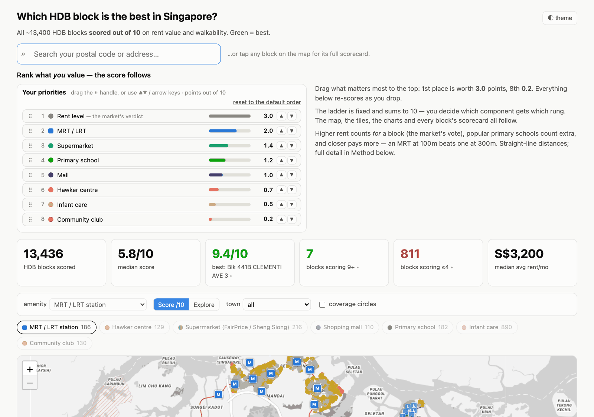
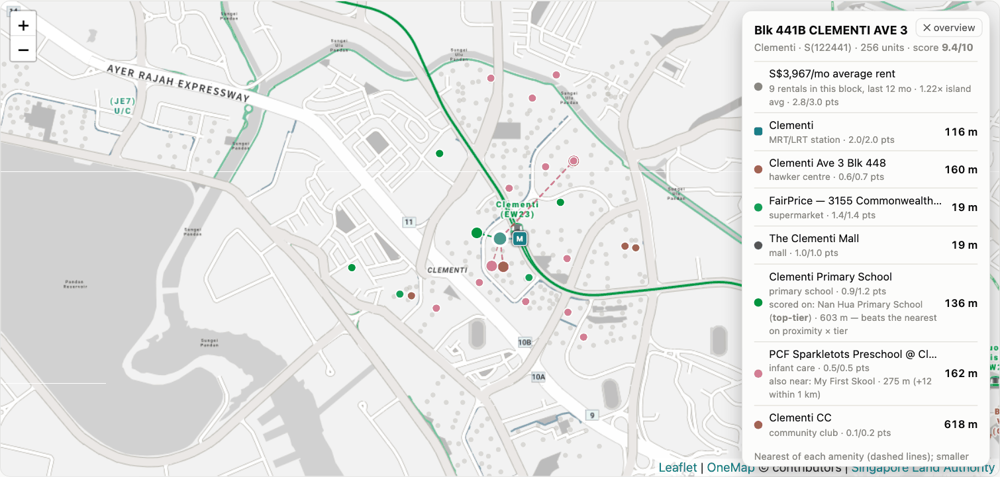
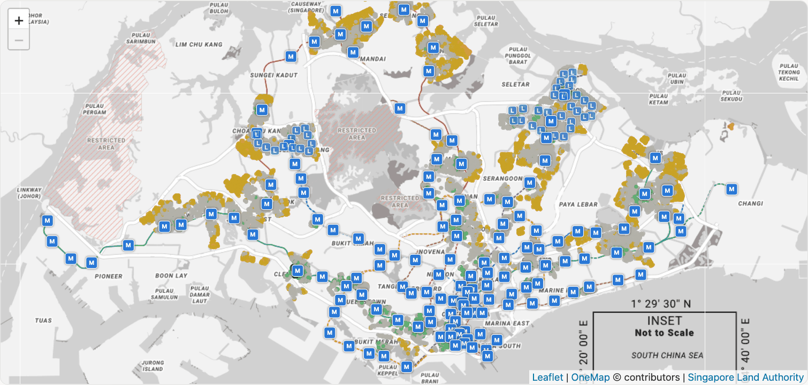
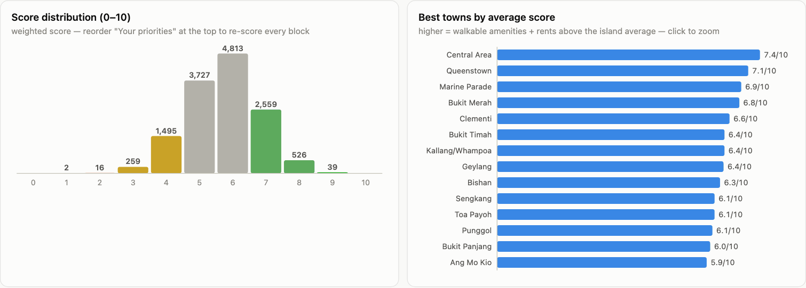

<div align="center">

# 🏠 Which HDB block is the best in Singapore?

### All 13,436 blocks, scored out of 10. You choose what matters.

Rent value and everyday walkability for every HDB block on the island.<br>
Search your postal code, or drag your priorities into order and watch the map re-score.

<br>

[](https://fang89.github.io/sg-house-analysis/)

**👉 [fang89.github.io/sg-house-analysis/](https://fang89.github.io/sg-house-analysis/)**

<br>


<br>

<a href="https://fang89.github.io/sg-house-analysis/"><picture><source media="(prefers-color-scheme: dark)" srcset="docs/screenshots/hero-dark.png"></picture></a>

</div>

---

## 🎚️ Rank what *you* value

The score is a fixed ladder of weights that sums to 10. Which component sits on which rung
is up to you: drag it up or down and every block, tile, chart and scorecard re-scores live.
Your order is remembered on your device. The default order:

| Rung | Component | Points | Data |
|:-:|---|:-:|---|
| 1 | 💰 **Rent level** | 3.0 | HDB rental approvals, last 12 months (41k transactions) |
| 2 | 🚇 **MRT / LRT** | 2.0 | 186 stations (145 MRT, 41 LRT), LTA exit layer |
| 3 | 🛒 **Supermarket** | 1.4 | 216 FairPrice and Sheng Siong stores, SFA licences |
| 4 | 🏫 **Primary school** | 1.2 | 182 schools, MOE, weighted by P1 demand |
| 5 | 🛍️ **Mall** | 1.0 | 110 major malls, editorial list |
| 6 | 🍜 **Hawker centre** | 0.7 | 129, NEA |
| 7 | 👶 **Infant care** | 0.5 | 890 ECDA centres offering infant places |
| 8 | 🏛️ **Community club** | 0.2 | 130, PA |

## 🔎 Every block has a scorecard

Search a postal code or address (OneMap), or tap any dot. You get the points for each
component, every distance, the average rent, the school it was scored on, and dashed lines
to the nearest of everything.

<p align="center"><a href="https://fang89.github.io/sg-house-analysis/"><picture><source media="(prefers-color-scheme: dark)" srcset="docs/screenshots/scorecard-dark.png"></picture></a></p>

## 🗺️ The whole island at a glance

Score mode colours every block from red to green; Explore mode shows plain dots so you can
switch amenity layers on and off. Filter by town or draw coverage circles.

<p align="center"><a href="https://fang89.github.io/sg-house-analysis/"><picture><source media="(prefers-color-scheme: dark)" srcset="docs/screenshots/map-dark.png"></picture></a></p>

<p align="center"><a href="https://fang89.github.io/sg-house-analysis/"><picture><source media="(prefers-color-scheme: dark)" srcset="docs/screenshots/charts-dark.png"></picture></a></p>

## 📊 Headline findings

With the default order (data of 11 July 2026):

| | | |
|:-:|---|---|
| 🏆 | **9.4 / 10** | the best block: Blk 441B Clementi Ave 3. Only **7** blocks score 9 or more |
| ⚖️ | **5.8 / 10** | the median block. **811** blocks score 4 or less |
| 🏙️ | **Central Area, Queenstown, Marine Parade** | the best towns on average (7.4, 7.1, 6.9) |
| 🏫 | **97%** | of blocks are within 1 km of a primary school |
| 🚇 | **72%** | are within 800 m of an MRT/LRT station (median 550 m) |
| 🛒 | **65%** | are within 500 m of a FairPrice or Sheng Siong |
| 🍜 | **39%** | are within 500 m of a hawker centre, the scarcest amenity (median 640 m) |
| 💵 | **S$3,200 / mo** | the median block-average rent. Island averages: 3-room S$2,790, 4-room S$3,335, 5-room S$3,542 |

---

## 🧮 How the score works

<details>
<summary>Method and caveats</summary>

<br>

- **Closer pays more.** Each amenity pays its full weight within 100 m, sliding to half at
  its benchmark distance and zero at 2× the benchmark. Benchmarks: supermarket and hawker
  500 m, MRT and infant care 800 m, school, mall and CC 1 km. They are editorial
  yardsticks, not official standards.
- **Rent is the market's verdict.** A block's rentals over the last 12 months are compared
  with the island average for the same flat types. A ratio of 1.25 or more earns the full
  3.0 points, fading linearly to 0 at 0.75. Blocks with fewer than 3 rentals use their
  town's ratio; blocks with no data at all score a neutral half. About 66% of blocks have
  their own transactions. Rents are owner-declared HDB approvals: indicative only.
- **Schools are weighted by demand.** 16 top-tier schools (perennially oversubscribed)
  count ×1.0, 25 popular schools ×0.85, the rest ×0.65. A block scores on its best
  proximity × tier, so a top school at 800 m can beat an average one at 300 m.
- **Several of one thing nearby adds no points.** It shows in the block panel instead.
- **Hawker sits low on purpose.** The open data covers only ~120 NEA hawker centres, not
  the kopitiams, coffeeshops and food courts where much of Singapore actually eats.
- **Distances are straight-line** from the building centroid; real walks are longer.
  MRT/LRT distance is to the station (the mean of its exits).
- **Every HDB building is included**, so a few "blocks" are carparks or commercial
  buildings. The top-50 table keeps only blocks with a known dwelling-unit count.
- **Supermarkets are FairPrice and Sheng Siong only**; an estate served by Giant, Cold
  Storage or Prime can still show as a gap.
- MOE's 1 km / 2 km school priority zones are defined by SLA per address and differ
  slightly from centroid distance.

</details>

---

## 🛠️ For contributors

### Repo layout

```
scripts/fetch_amenities.py   # pull + geocode all amenity layers -> data/amenities.json
scripts/analyze.py           # nearest-amenity distance per block -> docs/data/*.json
data/                        # raw inputs & OneMap geocode cache
docs/                        # the static dashboard (publish this folder)
docs/screenshots/            # images used in this README
```

### Refresh the data

```bash
python3 scripts/fetch_amenities.py   # ~10 min first run (OneMap ~1 req/s), instant re-runs (cached)
python3 scripts/analyze.py           # rebuilds docs/data/{blocks,amenities,summary}.json
```

Raw inputs in `data/` and how to re-download them:

| file | source |
|---|---|
| `sfa_supermarkets.json` | [SFA supermarket licences](https://data.gov.sg/datasets?query=supermarkets) (data.gov.sg) |
| `schools_raw.json` | [MOE School Directory](https://data.gov.sg/datasets/d_688b934f82c1059ed0a6993d2a829089/view) |
| `malls.txt` | editorial list (Wikipedia "List of shopping malls in Singapore"), names OneMap-searchable |
| `mrt_exits.geojson` | [LTA MRT/LRT Station Exit](https://data.gov.sg/datasets/d_b39d3a0871985372d7e1637193335da5/view) |
| `hawker_centres.geojson` | [NEA Hawker Centres](https://data.gov.sg/datasets/d_4a086da0a5553be1d89383cd90d07ecd/view) |
| `extra_communityclub.geojson` | [PA Community Clubs](https://data.gov.sg/datasets/d_9de02d3fb33d96da1855f4fbef549a0f/view) |
| `ecda_centres.json` + `childcare_centres.geojson` | [ECDA Listing of Centres](https://data.gov.sg/datasets/d_696c994c50745b079b3684f0e90ffc53/view) + [Child Care Services](https://data.gov.sg/datasets/d_5d668e3f544335f8028f546827b773b4/view) (infant-care filter) |
| `rents.json` | [Renting Out of Flats from Jan 2021](https://data.gov.sg/datasets/d_c9f57187485a850908655db0e8cfe651/view) (HDB, last 12 months kept) |
| `hdb_blocks_base.json` | HDB block centroids derived from [HDB Existing Building](https://data.gov.sg/datasets/d_16b157c52ed637edd6ba1232e026258d/view) (see the [atm-500m](https://github.com/fang89/atm-500m) pipeline) |

Any additional `data/extra_<name>.geojson` you drop in is picked up
automatically as a new layer (childcare centres, gyms, polyclinics…).

### Run locally

```bash
cd docs && python3 -m http.server 8000   # then open http://localhost:8000
```

### Deploy (free)

Push to GitHub → repo Settings → Pages → "Deploy from a branch" → branch
`main`, folder `/docs`. Plain static HTML + JSON, no build step.

## 📚 Sources & licences

Data: [data.gov.sg](https://data.gov.sg) datasets (SFA, MOE, LTA, NEA, PA, HDB) under the
[Singapore Open Data Licence](https://data.gov.sg/open-data-licence).
Geocoding and basemap: [OneMap](https://www.onemap.gov.sg/), Singapore Land Authority.
Mall list adapted from Wikipedia (CC BY-SA). Sister project:
[atm-500m](https://github.com/fang89/atm-500m), which supplies the HDB block centroids.
